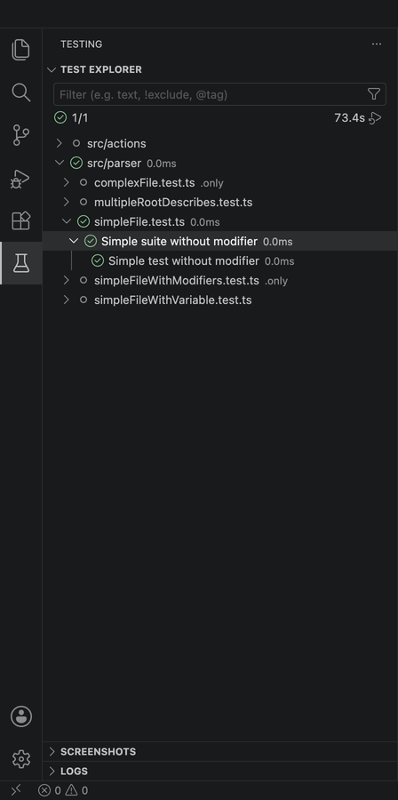

## Quick Start

1. Install the ExTester Runner extension from the VS Code marketplace
2. Open your VS Code extension project
3. Click the ExTester Runner icon in the Activity Bar
4. Find your test in the UI Tests view
5. Click the play button (▶️) to run it

## What is ExTester Runner?

ExTester Runner is a VS Code extension that provides a comprehensive UI for running and managing UI tests for VS Code extensions using the ExTester framework. It offers a seamless testing experience directly within VS Code, eliminating the need to switch between different tools or environments.

The extension integrates into VS Code's Activity Bar and provides three main views:

- **UI Tests**: A hierarchical view of test files and their structure (Mocha `describe/it` blocks)
- **Screenshots**: A view of screenshot image files captured during test runs
- **Logs**: A view of log files generated during test executions

## How it Works

### Core Functionality

1. **Test Discovery and Organization**
   - Automatically discovers test files based on configured glob patterns
   - Organizes tests in a hierarchical structure matching your project's folder layout
   - Supports Mocha's test structure with `describe` and `it` blocks
   - Provides visual indicators for test status and modifiers (`.only`, `.skip`)
   - Shows the number of test files in each folder and of tests in each file, and marks files that cannot be parsed
   - Shows next to the view title how many files contain `.only`, which makes Mocha skip every other test in the run
   - Explains an empty view and links to the setting that fixes it

2. **Test Execution**
   - One-click test running for individual files, folders or all tests
   - Supports running tests at different levels:
     - Test file (all tests in a file)
     - All test files in a folder
     - All tests in the workspace
   - Runs the test file open in the editor from the editor title bar, the Explorer context menu or the **ExTester Runner: Run Test File** command
   - Shows the running test in the status bar; click it, or the stop button in the UI Tests view, to stop the run. Only one run starts at a time
   - Reports whether a run passed or failed in a notification, with buttons to show the screenshots and logs or to run it again
   - **ExTester Runner: Rerun Last Run** repeats the last run with the current settings

3. **Test, Logs and Screenshots Management**
   - Automatic refresh of views when test files change
   - Provides quick navigation to test source code
   - Displays screenshots and logs sorted newest-first so the latest run is always at the top
   - Timestamp-named run folders show a human-readable date/time label (e.g. `Jan 15, 2025, 14:30:22`) with the raw folder name as secondary text
   - **Clear all** — removes the entire contents of the Logs or Screenshots directory in one click (with confirmation)
   - **Delete individual item** — removes a single file or folder from either view (inline trash icon or right-click > Delete, with confirmation)
   - **Reveal in File Explorer** — opens the Logs or Screenshots root directory, or any individual item, in the OS file manager (Finder on macOS, Explorer on Windows)

### Configuration

The extension supports both VS Code settings and a [project configuration](#project-configuration) in `extester.config.json`. All setting IDs are prefixed with `extesterRunner.` when editing `settings.json` by hand (e.g. `extesterRunner.testFileGlob`):

1. **View Configuration**
   - `testFileGlob`: Pattern to locate test files (default: `**/ui-test/**/*.test.ts`)
   - `excludeGlob`: Pattern to exclude paths from test search (default: `**/node_modules/**`)
   - `ignorePathPart`: Pattern to hide specific path segments in the test view

2. **Test Execution Settings**
   - `runSources`: Run the TypeScript test sources without compiling them; see [Running TypeScript Sources](#running-typescript-sources) (default: `false`)
   - `outputFolder`: Directory for compiled test files (default: `out`). Ignored when `runSources` is enabled
   - `rootFolder`: Root source directory for test files (default: not set). Ignored when `runSources` is enabled
   - `tempFolder`: Directory for temporary test files (default: not set — the system temporary folder is used)
   - `visualStudioCode.Version`: VS Code version for test execution — `max`, `min`, `latest`, or an exact version such as `1.97.1` (default: `max`)
   - `visualStudioCode.Type`: VS Code build type — `stable` or `insider` (default: `stable`)
   - `additionalArgs`: Additional CLI arguments for test runner (default: `[]`)
   - `configFile`: Path of the ExTester configuration file, relative to the workspace folder; see [Configuration file in a subfolder](#configuration-file-in-a-subfolder) (default: not set — `extester.config.json` in the workspace folder)

3. **Log Management**
   - `hideEmptyLogFolders`: Controls visibility of empty log directories (default: `true`)

## Setup and Configuration

### Project configuration

ExTester Runner reads shared project settings from `extester.config.json`, the same file that configures the [`extest` CLI](/vscode-extension-tester/guides/test-setup/). One file holds the settings of both tools, so the team does not have to commit `.vscode/settings.json`.

Put the Runner settings in the `runner` section, next to `setup` and `run`:

```json
{
  "$schema": "./node_modules/vscode-extension-tester/resources/extester.schema.json",
  "setup": { "vscodeVersion": "max", "type": "stable" },
  "run": { "mochaConfig": ".mocharc.js" },
  "runner": {
    "testFileGlob": "src/ui-test/**/*.test.ts",
    "rootFolder": "src",
    "outputFolder": "out",
    "ignorePathPart": "src/",
    "additionalArgs": []
  }
}
```

The `runner` section accepts `testFileGlob`, `excludeGlob`, `ignorePathPart`, `rootFolder`, `outputFolder`, `runSources` and `additionalArgs`, with the same meaning as the settings in the [Configuration](#configuration) section. Unknown properties and invalid values are reported as configuration errors. The `$schema` reference gives completion and validation for the whole file. The CLI ignores the `runner` section.

The VS Code version, the release type and the storage folder are not repeated in `runner`. The Runner reads them from the CLI sections, in the same order as `extest setup-and-run`:

| Runner setting             | Read from                                 |
| -------------------------- | ----------------------------------------- |
| `visualStudioCode.Version` | `setup.vscodeVersion`, then `run.vscodeVersion` |
| `visualStudioCode.Type`    | `setup.type`, then `run.type`             |
| `tempFolder`               | `setup.storage`, then `run.storage`       |

Relative paths and globs in the file are relative to the folder of the file, as for the CLI. `extends` works as for the CLI: the Runner merges the base files in the same way. See [Using a Config File](/vscode-extension-tester/guides/test-setup/#using-a-config-file) for the rest of the format.

Settings are resolved per key in this order, from lowest to highest priority:

1. the extension's built-in default,
2. your **user** settings (global, apply to every project),
3. **`extester.config.json`** (shared with the team),
4. **workspace** and **workspace-folder** settings (e.g. `.vscode/settings.json`).

The shared file therefore beats personal global defaults, while workspace settings act as a local, per-project override: once `.vscode/settings.json` is no longer committed, every contributor can use it to adjust a value such as `tempFolder` or the VS Code version for themselves. When a workspace setting overrides a value from the file, the extension shows a one-time notice that names the setting.

When the VS Code version, type or storage folder comes from the file, the Runner does not pass `--code_version`, `--type` or `--storage`, and the CLI reads the value from the file itself. When a VS Code setting overrides it, the Runner passes the setting, and it wins over the file for that run.

Omitted properties keep the VS Code setting or its default. An empty array replaces the settings array; it does not append to it. Empty strings and `false` are also explicit values. Projects without `extester.config.json` keep using VS Code settings.

The extension watches the file and updates test discovery, views and file watchers when it is created, edited or deleted, without reloading VS Code. It does not watch base files that the file `extends`: after editing one, use **Refresh** in the test view. An invalid file stops the test commands of its workspace folder, so they never run with fallback settings. Fix the reported error to continue. **Run All** skips that workspace folder and says why in the ExTester Runner output.

#### Configuration file in a subfolder

By default, the Runner reads `extester.config.json` in the workspace root, where the CLI finds it too: the Runner starts `extest` in the workspace root. In a monorepo where the file is in a package folder, point the `extesterRunner.configFile` setting to it, relative to the workspace root:

```json
{
  "extesterRunner.configFile": "packages/ui-tests/extester.config.json"
}
```

The Runner then reads that file and passes it to `extest setup-and-run` with `--config`. The file must be inside the workspace folder. Do not also put `--config` in `additionalArgs`: the Runner reports that as an error. `configFile` is a VS Code setting only, because it tells the Runner where the file is.

#### Multi-root workspaces

In a multi-root workspace, each root has its own `extester.config.json` (or `extesterRunner.configFile` folder setting). Test discovery and the file and folder commands use the configuration of the root that owns the tests, and run `extest` in that root. **Run All** runs the tests of each root separately, one root after another, and labels each task with the root name. Nested files are not discovered. The Logs and Screenshots views and their commands keep using the configuration of the first workspace folder.

#### Migrating from workspace settings

1. Move your shared `extesterRunner.*` values into the `runner` section of `extester.config.json`, without the `extesterRunner.` prefix. Move `visualStudioCode.Version`, `visualStudioCode.Type` and `tempFolder` to `setup.vscodeVersion`, `setup.type` and `setup.storage`.
2. If `additionalArgs` contains `--config`, set `extesterRunner.configFile` instead.
3. Remove the moved entries from `.vscode/settings.json`. Workspace settings take precedence over the file, so entries left behind keep overriding the shared values (the extension points this out with a notice). Then check test discovery and a test run.
4. If your project no longer needs to track any workspace settings, stop tracking that file and add `.vscode/settings.json` to `.gitignore`. Keep other shared `.vscode` files, such as extension recommendations and launch configurations, versioned.

The extension only reads `extester.config.json`. It does not write or migrate workspace settings.

### Initial Setup

The extension provides a built-in walkthrough to help you get started quickly. To access it:

1. Open VS Code
2. Go to the Command Palette (Ctrl+Shift+P / Cmd+Shift+P)
3. Type "Get started with ExTester Runner" and select it

The walkthrough will guide you through the essential configuration steps:

1. **Choose Compiled Tests or TypeScript Sources**
   - Compiled JavaScript (default): configure
     - Root Folder: Where your test files are located
     - Output Folder: Where compiled tests are stored
   - TypeScript sources: enable Run Sources to run the `.ts` files without compiling them (see [Running TypeScript Sources](#running-typescript-sources))

2. **Configure Test File Pattern**
   - Set up the pattern that ExTester Runner will use to find your test files
   - Default pattern: `**/ui-test/**/*.test.ts`

3. **Configure Excluded Paths**
   - Specify which paths should be excluded from test file searches
   - Default exclusion: `**/node_modules/**`

4. **Customize Path Display (Optional)**
   - Improve test view readability by hiding specific path segments

5. **Additional Arguments (Optional)**
   - Configure additional command line arguments for ExTester

6. **Additional Configuration Options**
   - Explore the remaining ExTester Runner settings

### Manual Configuration

If you prefer to configure the extension manually, you can access all settings through VS Code's settings panel:

1. Open VS Code Settings (Ctrl+, / Cmd+,)
2. Search for "ExTester Runner"
3. Configure the settings listed in the [Configuration](#configuration) section above (prefixed `extesterRunner.*` when editing `settings.json` directly)

### Running TypeScript Sources

By default, ExTester Runner runs the compiled JavaScript tests. It maps the selected file or folder from `rootFolder` to `outputFolder`. For example, with `rootFolder` set to `src`, `src/ui-test/a.test.ts` runs as `out/ui-test/a.test.js`. You have to compile the tests before each run.

ExTester 8.29.0 and later can [load TypeScript tests](/vscode-extension-tester/guides/typescript-tests/) with `tsx`. To run the test sources without compiling them, enable `runSources`:

```json
{
  "runner": {
    "testFileGlob": "packages/ui-tests/src/**/*.test.ts",
    "runSources": true
  }
}
```

The example uses the `runner` section of `extester.config.json` (see [Project configuration](#project-configuration)); the `extesterRunner.testFileGlob` and `extesterRunner.runSources` settings work the same way. The run commands then pass the sources to `extest setup-and-run` as they are and ignore `rootFolder` and `outputFolder`:

| Command    | Runs                                                                | Example                                     |
| ---------- | ------------------------------------------------------------------- | ------------------------------------------- |
| Run File   | The selected file                                                   | `packages/ui-tests/src/editor/Flow.test.ts` |
| Run Folder | The matching files directly in the folder                           | `packages/ui-tests/src/editor/*.test.ts`    |
| Run All    | The matching files below the deepest folder that contains all tests | `packages/ui-tests/src/**/*.test.ts`        |

The file pattern is the last segment of `testFileGlob`. The Runner passes absolute paths; the examples are relative to the workspace folder.

Requirements:

- `vscode-extension-tester` 8.29.0 or later.
- `tsx` that resolves from the workspace folder of the tests. The Runner starts `extest` in that folder, and ExTester resolves `tsx` from its working directory. In a monorepo, install `tsx` in the repository root, or let the package manager hoist it there.

The Runner does not check for `tsx` itself. If it is missing, ExTester reports it with install instructions before it downloads VS Code.

`tsx` does not type-check the tests, so keep a separate type check. The extension under test still has to be built as usual. See [Type checking and extension builds](/vscode-extension-tester/guides/typescript-tests/#type-checking-and-extension-builds).

### Getting Started

1. Install the ExTester Runner extension from the VS Code marketplace
2. Open your VS Code extension project
3. Configure the necessary settings through VS Code's settings panel
4. Use the Activity Bar to access the ExTester Runner views

The extension includes a built-in walkthrough to help users get started quickly, guiding them through the essential configuration steps.
