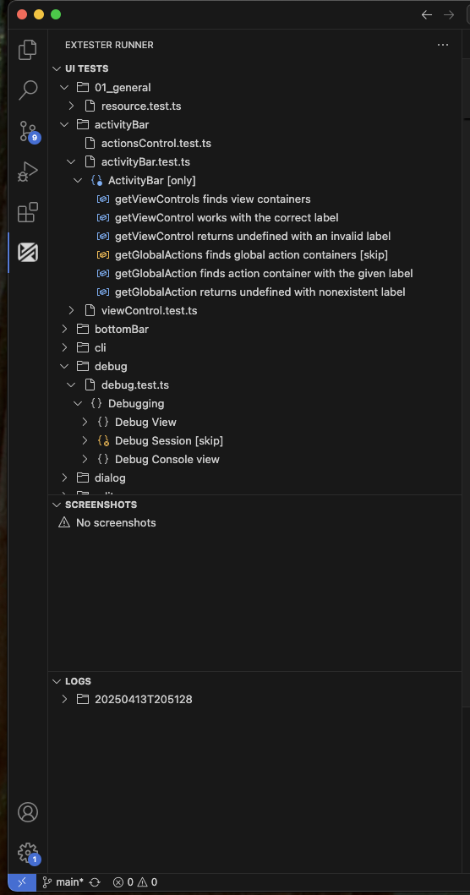

## Quick Start

1. Install the ExTester Runner extension from the VS Code marketplace
2. Open your VS Code extension project
3. Click the ExTester Runner icon in the Activity Bar
4. Find your test in the UI Tests view
5. Click the play button (▶️) to run it

## What is ExTester Runner?

ExTester Runner is a VS Code extension that provides a comprehensive UI for running and managing UI tests for VS Code extensions using the ExTester framework. It offers a seamless testing experience directly within VS Code, eliminating the need to switch between different tools or environments.

The extension integrates into VS Code's Activity Bar and provides three main views:

- **UI Tests**: A hierarchical view of test files and their structure (Mocha `describe/it` blocks)
- **Screenshots**: A view of screenshot image files captured during test runs
- **Logs**: A view of log files generated during test executions

## How it Works

### Core Functionality

1. **Test Discovery and Organization**
   - Automatically discovers test files based on configured glob patterns
   - Organizes tests in a hierarchical structure matching your project's folder layout
   - Supports Mocha's test structure with `describe` and `it` blocks
   - Provides visual indicators for test status and modifiers (`.only`, `.skip`)

2. **Test Execution**
   - One-click test running for individual files, folders or all tests
   - Supports running tests at different levels:
     - Test file (all tests in a file)
     - All test files in a folder
     - All tests in the workspace

3. **Test, Logs and Screenshots Management**
   - Automatic refresh of views when test files change
   - Provides quick navigation to test source code
   - Displays screenshots and logs sorted newest-first so the latest run is always at the top
   - Timestamp-named run folders show a human-readable date/time label (e.g. `Jan 15, 2025, 14:30:22`) with the raw folder name as secondary text
   - **Clear all** — removes the entire contents of the Logs or Screenshots directory in one click (with confirmation)
   - **Delete individual item** — removes a single file or folder from either view (inline trash icon or right-click > Delete, with confirmation)
   - **Reveal in File Explorer** — opens the Logs or Screenshots root directory, or any individual item, in the OS file manager (Finder on macOS, Explorer on Windows)

### Configuration

The extension supports both a [shared project configuration](#shared-project-configuration) and VS Code settings. All setting IDs are prefixed with `extesterRunner.` when editing `settings.json` by hand (e.g. `extesterRunner.testFileGlob`):

1. **View Configuration**
   - `testFileGlob`: Pattern to locate test files (default: `**/ui-test/**/*.test.ts`)
   - `excludeGlob`: Pattern to exclude paths from test search (default: `**/node_modules/**`)
   - `ignorePathPart`: Pattern to hide specific path segments in the test view

2. **Test Execution Settings**
   - `outputFolder`: Directory for compiled test files (default: `out`)
   - `rootFolder`: Root source directory for test files (default: not set)
   - `tempFolder`: Directory for temporary test files (default: not set — the system temporary folder is used)
   - `visualStudioCode.Version`: VS Code version for test execution — `max`, `min`, `latest`, or an exact version such as `1.97.1` (default: `max`)
   - `visualStudioCode.Type`: VS Code build type — `stable` or `insider` (default: `stable`)
   - `additionalArgs`: Additional CLI arguments for test runner (default: `[]`)

3. **Log Management**
   - `hideEmptyLogFolders`: Controls visibility of empty log directories (default: `true`)

## Setup and Configuration

### Shared project configuration

Create `.extester.json` directly in your workspace root to share ExTester Runner settings without committing `.vscode/settings.json`. The extension discovers the file automatically and provides JSON completion and validation.

```json
{
  "testFileGlob": "src/ui-test/**/*.test.ts",
  "rootFolder": "src",
  "outputFolder": "out",
  "ignorePathPart": "src/",
  "visualStudioCode": {
    "Version": "max",
    "Type": "stable"
  },
  "additionalArgs": [],
  "hideEmptyLogFolders": true
}
```

Use the setting names from the [Configuration](#configuration) section without the `extesterRunner.` prefix. Write `visualStudioCode.Version` and `visualStudioCode.Type` as properties of the nested `visualStudioCode` object shown above. The file is strict JSON: comments, unknown properties and invalid value types are reported as configuration errors.

Settings are resolved per key in this order, from lowest to highest priority:

1. the extension's built-in default,
2. your **user** settings (global, apply to every project),
3. **`.extester.json`** (shared with the team),
4. **workspace** and **workspace-folder** settings (e.g. `.vscode/settings.json`).

The shared project file therefore beats personal global defaults, while workspace settings act as a local, per-project override — once `.vscode/settings.json` is no longer committed, every contributor can use it to adjust a value such as `tempFolder` or the VS Code version for themselves. When a workspace setting overrides a value from `.extester.json`, the extension shows a one-time notice naming the setting.

Omitted properties retain the VS Code setting or its default. An empty array replaces the settings array; it does not append to it. Empty strings and `false` are also explicit values. Existing projects without `.extester.json` continue to use VS Code settings.

Glob patterns and source/output directories are relative to the workspace root containing `.extester.json`. Relative `tempFolder` paths and CLI command execution use that same root. The extension watches creation, editing and deletion of the file and updates test discovery, views and file watchers without reloading VS Code. An invalid project file prevents test commands from silently running with fallback settings; fix the reported error to continue.

#### Referencing CLI configuration

`.extester.json` configures the **VS Code extension**. The separate `extester.config.json` configures the **ExTester CLI** (`setup` and `run`). Use the optional `configFile` property to pass an existing CLI configuration to the test command:

```json
{
  "testFileGlob": "packages/ui-tests/src/**/*.test.ts",
  "rootFolder": "packages/ui-tests/src",
  "outputFolder": "packages/ui-tests/out",
  "ignorePathPart": "packages/ui-tests/",
  "configFile": "packages/ui-tests/extester.config.json",
  "additionalArgs": []
}
```

`configFile` is resolved relative to the workspace root and forwarded as `--config`. It cannot be combined with another `--config` in the effective `additionalArgs`; move that existing argument into `configFile` or keep using `additionalArgs` alone. The extension does not read or merge the CLI file. Other extension-generated CLI arguments retain their existing behavior; referencing a CLI file does not replace extension settings such as `testFileGlob` or `tempFolder`.

In a multi-root workspace, put a separate `.extester.json` in each root. Test discovery and file/folder commands use the owning root's configuration; **Run All** runs each root's tests separately. Nested `.extester.json` files are not discovered. The Logs and Screenshots views and their management commands continue to use the first workspace folder's resource configuration.

#### Migrating from workspace settings

1. Copy your shared `extesterRunner.*` values into `.extester.json`, removing the prefix and nesting the VS Code version/type fields.
2. Optionally replace a `--config` entry in `additionalArgs` with `configFile`.
3. Remove the migrated entries from `.vscode/settings.json` — workspace settings take precedence over `.extester.json`, so entries left behind keep overriding the shared values (the extension points this out with a notice). Then verify test discovery and execution.
4. If your project no longer needs to track any workspace settings, stop tracking that file and add `.vscode/settings.json` to `.gitignore`. Keep other shared `.vscode` files, such as extension recommendations and launch configurations, versioned.

The extension only reads `.extester.json`; it does not write or migrate workspace settings automatically.

### Initial Setup

The extension provides a built-in walkthrough to help you get started quickly. To access it:

1. Open VS Code
2. Go to the Command Palette (Ctrl+Shift+P / Cmd+Shift+P)
3. Type "Get started with ExTester Runner" and select it

The walkthrough will guide you through the essential configuration steps:

1. **Configure Root and Output Directories**
   - Set up your test environment by configuring:
     - Root Folder: Where your test files are located
     - Output Folder: Where compiled tests are stored

2. **Configure Test File Pattern**
   - Set up the pattern that ExTester Runner will use to find your test files
   - Default pattern: `**/ui-test/**/*.test.ts`

3. **Configure Excluded Paths**
   - Specify which paths should be excluded from test file searches
   - Default exclusion: `**/node_modules/**`

4. **Customize Path Display (Optional)**
   - Improve test view readability by hiding specific path segments

5. **Additional Arguments (Optional)**
   - Configure additional command line arguments for ExTester

6. **Additional Configuration Options**
   - Explore the remaining ExTester Runner settings

### Manual Configuration

If you prefer to configure the extension manually, you can access all settings through VS Code's settings panel:

1. Open VS Code Settings (Ctrl+, / Cmd+,)
2. Search for "ExTester Runner"
3. Configure the settings listed in the [Configuration](#configuration) section above (prefixed `extesterRunner.*` when editing `settings.json` directly)

### Getting Started

1. Install the ExTester Runner extension from the VS Code marketplace
2. Open your VS Code extension project
3. Configure the necessary settings through VS Code's settings panel
4. Use the Activity Bar to access the ExTester Runner views

The extension includes a built-in walkthrough to help users get started quickly, guiding them through the essential configuration steps.
