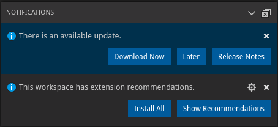

## Lookup

To open the notifications center, use either `Workbench` or `StatusBar` object:

```typescript
import { Workbench, StatusBar, NotificationType } from 'vscode-extension-tester';
...
center = await new Workbench().openNotificationsCenter();
center1 = await new StatusBar().openNotificationsCenter();
```

## Get the Notifications

```typescript
// get all notifications
const notifications = await center.getNotifications(NotificationType.Any);
// get info notifications
const infos = await center.getNotifications(NotificationType.Info);
```

`getNotifications` opens the center again if VS Code has closed it (and throws `Notifications center did not open` if it cannot, as `StatusBar.openNotificationsCenter()` does). It waits for each row to show, as before, but leaves out a row that does not show in time instead of failing.

## Wait for a Notification

A notification can reach the center a while after the action that shows it, and the newest one is not always the one you want. Wait for it by its message instead of taking the first one:

```typescript
// text the message contains, or a regular expression; the timeout defaults to 10 s
const notification = await center.waitForNotification('This is a notification', 15000);
```

## Clear and Close

```typescript
// clear all notifications
await center.clearAllNotifications();
// close the notifications center
await center.close();
```
