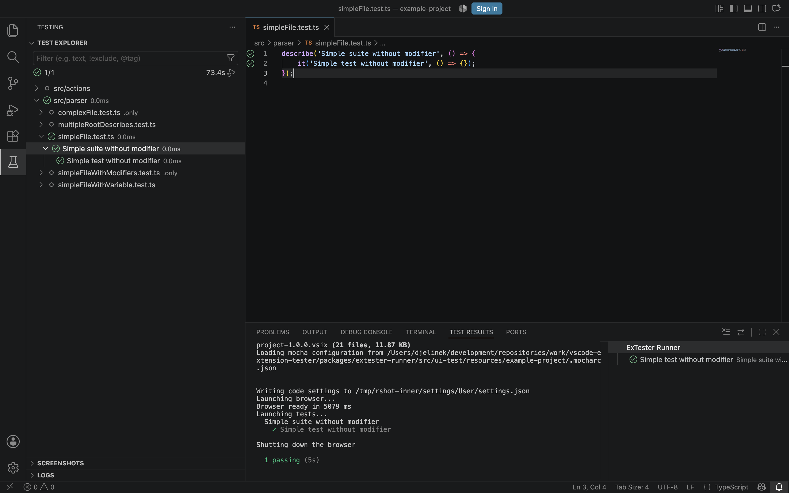

<h1 align="center">ExTester Runner</h1>

<p align="center">Run and manage <a href="https://www.npmjs.com/package/vscode-extension-tester">ExTester</a> UI tests for your VS Code extension without leaving VS Code.</p>

<p align="center">
  
</p>

## Quick start

1. Install the extension from the [Visual Studio Marketplace](https://marketplace.visualstudio.com/items?itemName=redhat.extester-runner) or the [Open VSX Registry](https://open-vsx.org/extension/redhat/extester-runner).
2. Open the extension project that contains your ExTester UI tests.
3. Open the Command Palette, run **Welcome: Open Walkthrough...** and pick **Get started with ExTester Runner**. The walkthrough stores the source and output folders, or the choice to run TypeScript sources, and the test file pattern in your workspace settings.
4. Click the **ExTester Runner** icon in the Activity Bar, find a test in the **UI Tests** view and press its play button (▶️).

## Requirements

- A VS Code extension project with UI tests written in TypeScript using [vscode-extension-tester](https://www.npmjs.com/package/vscode-extension-tester).
- Node.js 22 or newer, as required by ExTester.
- VS Code 1.100 or newer.
- To run the TypeScript sources without compiling them (`runSources`): vscode-extension-tester 8.29.0 or newer and [`tsx`](https://redhat-developer.github.io/vscode-extension-tester/guides/typescript-tests/) installed where ExTester runs (see [Running TypeScript sources](#running-typescript-sources)).

## Features

### Three views in one Activity Bar container

- **UI Tests** shows every file matched by your test glob as a tree of folders, files, `describe` suites and `it` cases, marks `.only` and `.skip` modifiers, and jumps to the source when you click a node.
- **Screenshots** lists the screenshots captured during test runs.
- **Logs** lists the log files written by test runs.

### One-click test runs

- Run a single file, a whole folder, or every test in the workspace from the play buttons in the **UI Tests** view.
- Each run calls `extest setup-and-run` with the VS Code version, release type and extra arguments from your settings.
- Run the compiled JavaScript tests from your output folder, or the TypeScript sources with [`runSources`](#running-typescript-sources).

### Always up to date

- The **UI Tests** view refreshes when test files are added, removed or changed, and when the runner settings or `extester.config.json` change.
- The **Screenshots** and **Logs** views refresh when files are created, deleted or modified during a run.
- Clear, delete or reveal screenshots and logs from the view toolbars and context menus.

## Settings

All settings live under the `extesterRunner` namespace in your workspace settings. To share them with your team, put them in [`extester.config.json`](#project-configuration) instead.

**View**

| Setting          | Default                   | Description                                                      |
| ---------------- | ------------------------- | ---------------------------------------------------------------- |
| `testFileGlob`   | `**/ui-test/**/*.test.ts` | Glob pattern that locates test files.                            |
| `excludeGlob`    | `**/node_modules/**`      | Glob pattern for paths to leave out of the search.               |
| `ignorePathPart` | —                         | Path segment hidden from folder labels in the **UI Tests** view. |

**Command line**

| Setting                    | Default            | Description                                                                                                                |
| -------------------------- | ------------------ | -------------------------------------------------------------------------------------------------------------------------- |
| `runSources`               | `false`            | Run the TypeScript test sources without compiling them. `rootFolder` and `outputFolder` are then ignored.                  |
| `rootFolder`               | —                  | Root of your TypeScript test sources. When set, this segment is dropped when mapping a source file to its compiled output. |
| `outputFolder`             | `out`              | Directory with the compiled JavaScript test files.                                                                         |
| `tempFolder`               | system temp folder | Directory ExTester uses for the downloaded VS Code, ChromeDriver and other test resources.                                 |
| `visualStudioCode.Version` | `max`              | VS Code version to test with: `max`, `min`, `latest` or an exact version such as `1.97.1`.                                 |
| `visualStudioCode.Type`    | `stable`           | `stable` or `insider`.                                                                                                     |
| `additionalArgs`           | `[]`               | Extra arguments passed to `extest setup-and-run`.                                                                          |
| `configFile`               | —                  | Path of the ExTester configuration file, relative to the workspace folder. Default: `extester.config.json` in the folder.  |

**Logs**

| Setting               | Default | Description                             |
| --------------------- | ------- | --------------------------------------- |
| `hideEmptyLogFolders` | `true`  | Hide log folders that contain no files. |

## Project configuration

ExTester Runner also reads `extester.config.json`, the configuration file of the `extest` CLI, from the workspace folder. Put the Runner settings in its `runner` section. The VS Code version, type and storage folder come from the `setup` and `run` sections, so they are defined once for both tools:

```json
{
  "setup": { "vscodeVersion": "max", "type": "stable" },
  "runner": {
    "testFileGlob": "src/ui-test/**/*.test.ts",
    "rootFolder": "src",
    "outputFolder": "out"
  }
}
```

Paths in the file are relative to the file. Values from the file beat your user settings, and workspace settings beat the file. If the file is in a subfolder, point `extesterRunner.configFile` to it. See the [ExTester Runner guide](https://redhat-developer.github.io/vscode-extension-tester/guides/extester-runner/#project-configuration).

## Running TypeScript sources

By default, a run maps the selected test from `rootFolder` to `outputFolder` (for example `src/ui-test/a.test.ts` to `out/ui-test/a.test.js`), so the tests have to be compiled first. ExTester 8.29.0 and later load TypeScript tests with `tsx`, so you can skip that step:

```json
{
  "extesterRunner.testFileGlob": "packages/ui-tests/src/**/*.test.ts",
  "extesterRunner.runSources": true
}
```

With `runSources` enabled, **Run File** passes the selected `.ts` file to `extest setup-and-run`, **Run Folder** the matching files in the folder (`<folder>/*.test.ts`) and **Run All** the matching files below the folder that contains all tests (`<folder>/**/*.test.ts`).

ExTester resolves `tsx` from its working directory, and the runner starts `extest` in the workspace folder of the tests. In a monorepo, install `tsx` in the repository root or let your package manager hoist it there. If `tsx` is missing, ExTester reports it with install instructions before it downloads VS Code. See the [TypeScript tests guide](https://redhat-developer.github.io/vscode-extension-tester/guides/typescript-tests/).

## Logging

The **ExTester Runner** output channel records test execution status, file discovery, debug messages and errors.

## Documentation

- [ExTester Runner guide](https://redhat-developer.github.io/vscode-extension-tester/guides/extester-runner/)
- [ExTester documentation](https://redhat-developer.github.io/vscode-extension-tester/) — how to write and configure the tests the runner executes

## Feedback

- Bugs and feature requests: [open an issue](https://github.com/redhat-developer/vscode-extension-tester/issues/new/choose)
- Questions: [GitHub Discussions](https://github.com/redhat-developer/vscode-extension-tester/discussions)
- Source code and change history: [packages/extester-runner](https://github.com/redhat-developer/vscode-extension-tester/tree/main/packages/extester-runner)

## License

[Apache License 2.0](https://github.com/redhat-developer/vscode-extension-tester/blob/main/LICENSE)
